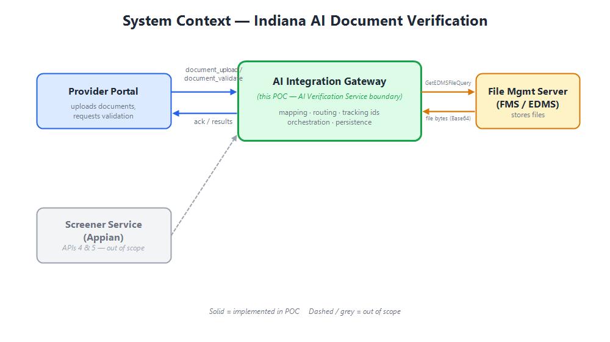
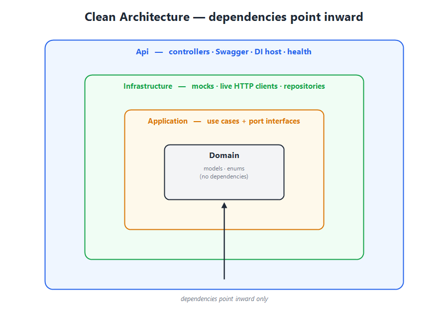
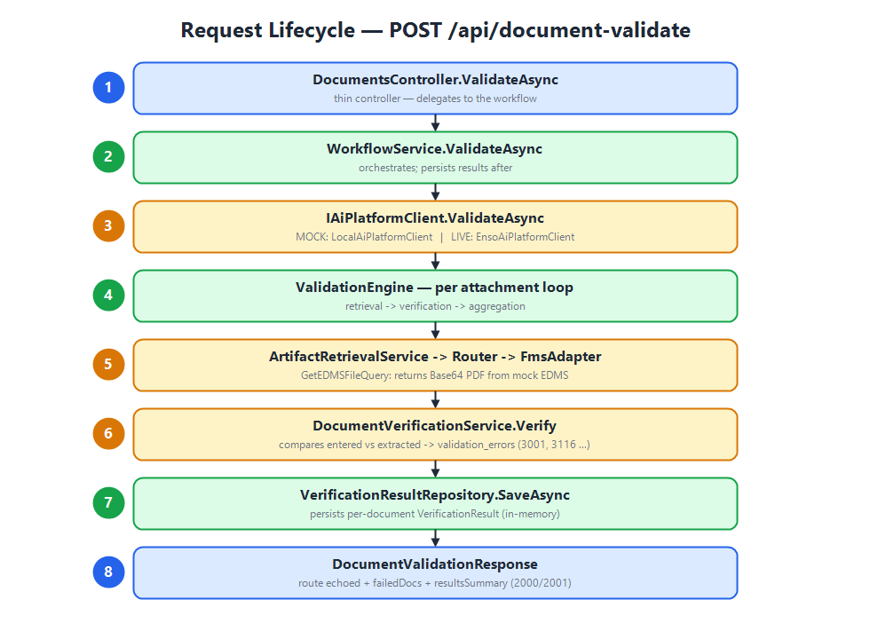
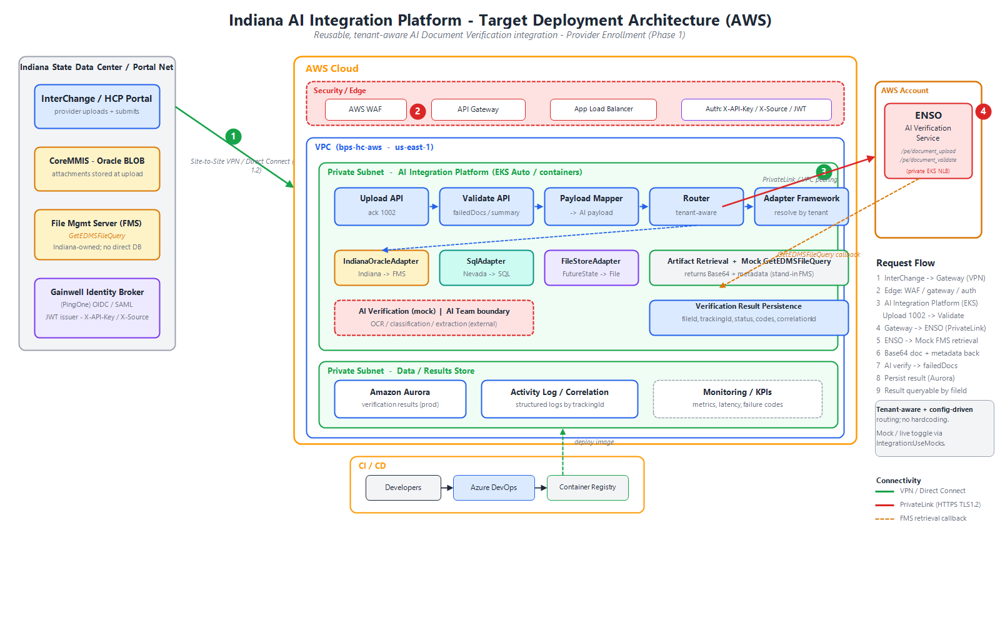

# Indiana AI Document Verification Integration — Architecture Guide

**Audience:** Developers joining the project
**Author:** Solution Architecture
**Status:** POC (proof-of-concept)
**Runtime:** .NET 8 · ASP.NET Core Web API · Clean Architecture

---

## Table of Contents

1. [What this project is (and is not)](#1-what-this-project-is-and-is-not)
2. [The business problem](#2-the-business-problem)
3. [System context — who talks to whom](#3-system-context--who-talks-to-whom)
4. [The five APIs](#4-the-five-apis)
5. [Architectural style: Clean Architecture](#5-architectural-style-clean-architecture)
6. [Project structure & responsibilities](#6-project-structure--responsibilities)
7. [The request lifecycle (end to end)](#7-the-request-lifecycle-end-to-end)
8. [Key abstractions (the seams)](#8-key-abstractions-the-seams)
9. [Mock vs live — the toggle](#9-mock-vs-live--the-toggle)
10. [The domain model](#10-the-domain-model)
11. [Validation & error codes](#11-validation--error-codes)
12. [Cross-cutting concerns](#12-cross-cutting-concerns)
13. [Testing strategy](#13-testing-strategy)
14. [How to run & explore](#14-how-to-run--explore)
15. [Design decisions & trade-offs (FAQ)](#15-design-decisions--trade-offs-faq)
16. [Roadmap to production](#16-roadmap-to-production)
17. [Glossary](#17-glossary)

---

## 1. What this project is (and is not)

This is a **proof-of-concept** that demonstrates the architecture of the Indiana
AI Document Verification integration. Its job is to make the agreed design
**tangible and runnable** so the team can validate the contracts and the flow
before committing to the full build.

**It IS:**
- A faithful implementation of the **real API contracts** (`document_upload`,
  `document_validate`, `GetEDMSFileQuery`) — same JSON shapes as the AI team's schema.
- A working ASP.NET Core service with Swagger you can call today.
- A clean, layered codebase organized so the mocks can be replaced with live
  integrations without rewrites.

**It is NOT:**
- A production system. The AI verification engine, the File Management Server
  (FMS/EDMS) and the results database are **mocked**.
- The Screener flow (APIs 4 & 5) — those are out of scope for this POC.

> **Mental model:** think of this as the "AI Integration Gateway" — the
> middleware that sits between the Provider Portal and the AI Verification
> Service, doing mapping, routing, correlation and orchestration.

---

## 2. The business problem

Indiana Medicaid provider enrollment requires **document verification**. A
provider (or facility) submits an enrollment with attachments — W-9, hospital
license, CLIA certificate, DEA certificate, etc. Someone has to confirm that
**what the provider typed** matches **what the documents actually say**.

Doing this manually is slow and error-prone. The AI Verification Service
automates it: it reads each uploaded document, extracts the key fields, and
compares them against the entered enrollment data, flagging mismatches (wrong
document type, mismatched license number, mismatched address, expired dates,
and so on).

This project is the **integration layer** that lets the Provider Portal drive
that AI service.

---

## 3. System context — who talks to whom

```
┌─────────────────┐   document_upload / validate   ┌───────────────────────────┐
│ Provider Portal │ ─────────────────────────────► │   AI Verification Service │
│                 │ ◄───────────────────────────── │        (Enso)             │
└─────────────────┘   ack / validation results     └───────────┬───────────────┘
                                                                │ needs the file bytes
                                                                ▼
                                                    ┌───────────────────────────┐
                                                    │  File Management Server    │
                                                    │  (FMS / EDMS)              │
                                                    └───────────────────────────┘

┌─────────────────┐   screener/document_upload     ┌───────────────────────────┐
│ Screener Service│ ─────────────────────────────► │   AI Verification Service │
│  (Appian)       │ ◄───────────────────────────── │                           │
└─────────────────┘   peApplicationReviewResponse  └───────────────────────────┘
        (APIs 4 & 5 — out of scope for this POC)
```

**In this POC, we play the role of the AI Integration Gateway / AI Verification
Service boundary.** We accept the portal's calls, and we *simulate* the AI engine
and the FMS behind them.



---

## 4. The five APIs

| # | API | Endpoint (real) | Source → Target | Auth | In POC? |
|---|-----|-----------------|-----------------|------|---------|
| 1 | Document upload | `/pe/document_upload` | Portal → AI Service | `X-API-Key`, `X-Source` | ✅ `POST /api/document-upload` |
| 2 | FMS file download | `.../GetEDMSFileQuery` | AI Service → FMS | — | ✅ `POST /api/artifact-retrieval` |
| 3 | Document validate | `/pe/document_validate` | Portal → AI Service | `X-API-Key`, `X-Source` | ✅ `POST /api/document-validate` |
| 4 | Screener request | `/pe/screener/document_upload` | Screener → AI Service | `X-API-Key`, `X-Source` | ❌ out of scope |
| 5 | Screener disposition | `peApplicationReviewResponse` | AI Service → Screener | — | ❌ out of scope |

**Upload vs Validate** — same request body, different phase:
- **Upload (1)** is a fast *acknowledgement*. It maps the payload, mints tracking
  ids, confirms routing, and returns `ack_status` (1002/PASS). It does **not**
  fetch files or run the AI.
- **Validate (3)** is the *real work*. For each attachment it pulls the file
  (via API 2), runs the AI comparison, persists a result, and returns
  `failedDocs` + `resultsSummary` (2000 PASS / 2001 FAIL).

---

## 5. Architectural style: Clean Architecture

We use **Clean Architecture** (a.k.a. Ports & Adapters / Hexagonal). The guiding
rule is the **Dependency Rule**: source code dependencies point **inward only**.



```
        ┌───────────────────────────────────────────────┐
        │                    Api                         │  ← controllers, Swagger, DI host
        │   ┌───────────────────────────────────────┐   │
        │   │            Infrastructure             │   │  ← mocks, live HTTP clients, repos
        │   │   ┌───────────────────────────────┐   │   │
        │   │   │          Application          │   │   │  ← use cases, port interfaces
        │   │   │   ┌───────────────────────┐   │   │   │
        │   │   │   │        Domain         │   │   │   │  ← models, enums (no dependencies)
        │   │   │   └───────────────────────┘   │   │   │
        │   │   └───────────────────────────────┘   │   │
        │   └───────────────────────────────────────┘   │
        └───────────────────────────────────────────────┘

Dependencies:  Api → Application → Domain
               Api → Infrastructure → Application → Domain
```

**Why this matters to you as a developer:**
- **Domain** and **Application** know *nothing* about HTTP, Enso, or FMS. They're
  pure C# you can unit-test in milliseconds.
- **Infrastructure** implements the interfaces the Application *declares*. This is
  the "dependency inversion" — the inner layer owns the contract, the outer layer
  obeys it.
- Swapping a mock for a real integration is an **Infrastructure-only** change.

---

## 6. Project structure & responsibilities

```
Indiana.AI.Integration.sln
├── src
│   ├── Indiana.AI.Domain          # The "what": models & enums. Zero dependencies.
│   ├── Indiana.AI.Application      # The "how": use cases + port interfaces (Abstractions).
│   ├── Indiana.AI.Infrastructure   # The "with what": mocks, live HTTP clients, persistence.
│   └── Indiana.AI.Api              # The "entry": controllers, Swagger, DI wiring, health.
├── tests
│   └── Indiana.AI.Tests            # xUnit tests for the inner layers.
└── samples                         # Real schema (API-Schema.yaml) + sample payloads.
```

### `Indiana.AI.Domain`
The vocabulary of the system. Plain C# classes (POCOs) and enums that mirror the
PE API schema: `Route`, `Enrollment`, `ProviderInformation` (and its many
sub-objects), `Attachment`, `UploadRequest`, `UploadResponse`,
`DocumentValidationResponse`, the FMS `GetEdmsFileRequest/Response`, plus internal
types (`TrackingContext`, `AIVerificationPayload`, `VerificationResult`).
No behavior, no dependencies — this layer can't reference anything else.

### `Indiana.AI.Application`
The business logic and — crucially — the **interfaces** (ports) that describe
what the outer world must provide:
- **Abstractions/** — `IAiPlatformClient`, `IAIPayloadMapper`, `IRouter`,
  `IValidationEngine`, `IWorkflowService`, `IDocumentAdapter`, `IAdapterResolver`,
  `IArtifactRetrievalService`, `IDocumentVerificationService`,
  `IVerificationResultRepository`.
- **Mapping/** — `AIPayloadMapper` (enrollment → canonical AI payload, tracking ids).
- **Services/** — `Router`, `ValidationEngine`, `WorkflowService`,
  `LocalAiPlatformClient` (the in-process/mock AI platform).

### `Indiana.AI.Infrastructure`
Concrete implementations of the ports:
- **Adapters/** — `FmsAdapter` + `MockEdmsRepository` (seeded PDFs),
  `FileStorageAdapter`, `AdapterResolver`, `MockDocumentVerificationService` +
  `MockExtractionDataset`.
- **Live/** — `EnsoAiPlatformClient` (real API 1 & 3), `RealFmsAdapter` (real API 2).
- **Persistence/** — `InMemoryVerificationResultRepository`.
- **Configuration/** — `IntegrationOptions` (the `UseMocks` toggle + endpoints).

### `Indiana.AI.Api`
The composition root and HTTP surface:
- **Controllers/** — `DocumentsController` (the 4 document routes),
  `StatusController`.
- **Program.cs** — registers `AddApplication()` + `AddInfrastructure(config)`,
  configures Swagger, health checks, and the root→Swagger redirect.

---

## 7. The request lifecycle (end to end)

Here's what happens on `POST /api/document-validate` (the most interesting path):



```
1. DocumentsController.ValidateAsync(request)
       │
2. IWorkflowService.ValidateAsync(request)
       │   (WorkflowService)
3. ├─► IAiPlatformClient.ValidateAsync(request)
       │        (LocalAiPlatformClient in mock mode / EnsoAiPlatformClient in live mode)
       │        │
4.     │        └─► IValidationEngine.ValidateAsync(request, tracking)
       │                 │   for each attachment:
5.     │                 ├─► IArtifactRetrievalService.RetrieveByFileIdAsync(fileId)
       │                 │        └─► IRouter.ResolveChannel("Provider Enrollment") → "FMS"
       │                 │        └─► IAdapterResolver.Resolve("FMS") → FmsAdapter
       │                 │        └─► FmsAdapter.GetArtifactAsync(fileId) → EDMS record (Base64 PDF)
6.     │                 ├─► IDocumentVerificationService.Verify(attachment, provider, artifact)
       │                 │        └─► compares entered vs extracted → List<ValidationError>
7.     │                 └─► aggregates FailedDocs + ResultsSummary (counts)
       │
8. ├─► for each attachment: IVerificationResultRepository.SaveAsync(result)
       │
9. └─► returns DocumentValidationResponse (route echoed + failedDocs + resultsSummary)
```

**Reading the flow:** the controller is thin. `WorkflowService` orchestrates.
The AI platform boundary (`IAiPlatformClient`) is where mock/live diverge. Under
the mock, the `ValidationEngine` walks each document through **retrieval →
verification → aggregation**, and the workflow persists the per-document outcome.

The **upload** path (API 1) is the same shape but stops at the acknowledgement —
no retrieval, no verification, no persistence.

---

## 8. Key abstractions (the seams)

These interfaces are the joints where the system flexes. Learn these and you
understand the architecture.

| Interface | Responsibility | Mock impl | Live impl |
|-----------|----------------|-----------|-----------|
| `IAiPlatformClient` | The AI Verification Service boundary (upload + validate) | `LocalAiPlatformClient` | `EnsoAiPlatformClient` |
| `IDocumentAdapter` | Fetch a document artifact for a channel | `FmsAdapter` | `RealFmsAdapter` |
| `IAdapterResolver` | Pick the adapter for a channel | `AdapterResolver` | (same) |
| `IArtifactRetrievalService` | Retrieve via router + adapter (API 2) | `ArtifactRetrievalService` | (same) |
| `IDocumentVerificationService` | The AI extraction/compare (mocked) | `MockDocumentVerificationService` | *(replace w/ real AI)* |
| `IVerificationResultRepository` | Persist/read results | `InMemoryVerificationResultRepository` | *(replace w/ DB)* |
| `IRouter` | Module → channel routing | `Router` | (same) |
| `IValidationEngine` | Orchestrate per-document validation | `ValidationEngine` | (same) |
| `IWorkflowService` | Top-level facade for controllers | `WorkflowService` | (same) |
| `IAIPayloadMapper` | Enrollment → canonical payload + tracking | `AIPayloadMapper` | (same) |

**The adapter framework** deserves a special mention. Multiple
`IDocumentAdapter`s register (each with a `Channel` like `"FMS"` or
`"FileStorage"`); `AdapterResolver` builds a dictionary keyed by channel and
hands back the right one at runtime. This is the **Strategy pattern** — add a new
back-end by adding a new adapter, no changes to callers.

---

## 9. Mock vs live — the toggle

A single config flag selects the mode. **No code changes** to switch.

```jsonc
// appsettings.json
"Integration": {
  "UseMocks": true,                       // false → live Enso + FMS
  "Enso": {
    "BaseUrl": "https://enso-apis.enso.dev.pgwcloud.net",
    "UploadPath": "/pe/document_upload",
    "ValidatePath": "/pe/document_validate",
    "ApiKey": "",                          // issued X-API-Key
    "Source": "provider_portal"            // X-Source
  },
  "Fms": {
    "BaseUrl": "https://bas-fltest-perf.mapshc.com/HPP.Core.FileMgmtApi",
    "GetEdmsFilePath": "/R6.0/FileMgmtQuery/GetEDMSFileQuery"
  }
}
```

`AddInfrastructure(configuration)` reads `UseMocks`:

```csharp
return options.UseMocks
    ? services.AddMockIntegration()      // LocalAiPlatformClient + FmsAdapter + mock AI
    : services.AddLiveIntegration(options); // EnsoAiPlatformClient + RealFmsAdapter (typed HttpClients)
```

The live registration configures typed `HttpClient`s with the base address and
the `X-API-Key` / `X-Source` headers. Because the two integrations
(`IAiPlatformClient` and `IDocumentAdapter`) are independent, you can run a
**hybrid** — e.g. live FMS + mock AI — by mixing the registrations.

> **Design intent:** the POC ships mock-first (`UseMocks: true`) so it runs with
> zero credentials. Onboarding = drop in the API key and flip the flag.

---

## 10. The domain model

The models mirror the PE API schema exactly (property names via
`[JsonPropertyName]`), so the wire JSON matches the AI team's samples.

**The envelope — `Route`.** Every AI-service call carries a `route` block. Think
of it as *headers in the body*: `domain`, `apiVer`, `tenantID`, `appClient`,
`requestGUID` (correlation id), `requestType` (`document_upload` /
`document_validate`), `timeStampId`. Responses **echo it back** so callers can
correlate.

**The payload — `Enrollment` → `ProviderInformation`.** This is deep and real:
business & individual info, specialties, CLIA/license/DEA details, PE
certifications, malpractice insurance, addresses, attachments, EFT, education,
backdate request, etc. `Attachment` is the key sub-object:
`{ fileId, fileName, attachmentTypeCode, attachmentTypeName }`.

**Responses.**
- `UploadResponse` = `route` + `ack_status { code, status, processingTimeMs, timestamp }`.
- `DocumentValidationResponse` = `route` + `failedDocs[]` + `resultsSummary`
  (with `totalDocs / passedDocs / failedDocs / errorDocs`).
- `GetEdmsFileResponse` = the FMS `where` / `queryResult` envelope, with
  `fileData` as Base64.

**Internal (not on the wire).** `TrackingContext` (correlation threaded through
the workflow), `AIVerificationPayload` (the canonical shape the mapper produces),
`VerificationResult` (what we persist).

---

## 11. Validation & error codes

Two families of codes:

**Acknowledgement / summary:**

| Code | Meaning |
|------|---------|
| 1002 | Upload accepted |
| 2000 | Validation passed |
| 2001 | Validation failed |
| 4004 | File / result not found |

**Field-level `validation_errors`** (from the AI sample):

| Code | Meaning |
|------|---------|
| 3001 | attachment type mismatch |
| 3101 | name / legal name mismatch |
| 3109 | address mismatch |
| 3116 | CLIA number mismatch |
| 3120 | tax id mismatch |
| 3123 | license number mismatch |
| 3127 | effective date mismatch |
| 3129 | expiration / end date mismatch |
| 3133 | generic field mismatch |
| 3150 | issue date mismatch |

**How the mock produces them.** `MockExtractionDataset` holds a per-fileId
"extraction profile" — what the AI *pretends* to read from each document.
`MockDocumentVerificationService` compares each profile field against the entered
enrollment value; a mismatch emits the matching error code. This is why
validating the provided sample payload reproduces the AI's sample response
(5 failed docs across 6 attachments, same codes and entered/extracted values).

In **live** mode, this whole step is replaced by the real AI engine — the codes
and shapes stay identical, only the source of truth changes.

---

## 12. Cross-cutting concerns

- **Correlation / tracing.** `AIPayloadMapper` derives `TrackingContext` from
  `route.requestGUID` and `enrollment.trackingID`, threaded through validation and
  persistence so one enrollment is traceable end-to-end.
- **Serialization.** `System.Text.Json` with explicit `[JsonPropertyName]` to
  match the exact wire contract (`ack_status`, `validation_errors`, camelCase).
- **Async & cancellation.** All I/O-facing methods are `async` and take a
  `CancellationToken`.
- **Error handling.** Missing artifacts surface as `KeyNotFoundException`, mapped
  to `404` + code `4004` at the controller. In validation they're counted as
  `errorDocs`.
- **Health & discoverability.** `GET /health`, `GET /api/status`, Swagger at
  `/swagger`, root redirects to Swagger, XML doc comments surfaced in the UI.
- **Configuration & DI.** Options bound from the `Integration` section;
  everything wired through constructor injection (no service-locator, no statics).

---

## 13. Testing strategy

`Indiana.AI.Tests` (xUnit) targets the **inner layers**, which are pure and fast:

- **Payload mapping** — tracking ids derived from route/enrollment; projection.
- **Router** — module→channel mapping, defaults, supported channels.
- **Artifact retrieval** — `GetEDMSFileQuery` envelope, Base64 PDF, not-found.
- **Validation engine** — PASS on clean doc; FAIL with `3001` and the CLIA
  field-mismatch codes; multi-document counts.
- **Local AI platform client** — ack 1002 + route echo; validate delegates.
- **Repository** — save / get / overwrite.

Tests construct the mock stack directly (no HTTP), so the suite runs in ~100ms.
The Tests project intentionally does **not** reference the Api project, so it runs
on the plain net8.0 runtime.

> **Testability is a feature of the architecture**, not an afterthought. Because
> the logic lives in the inner layers behind interfaces, we test behavior without
> spinning up a web host or hitting a network.

---

## 14. How to run & explore

```bash
# Build & test
dotnet build Indiana.AI.Integration.sln
dotnet test  Indiana.AI.Integration.sln

# Run the API (mock mode by default)
dotnet run --project src/Indiana.AI.Api
```

Open the root URL → it redirects to **Swagger**. Or use
`src/Indiana.AI.Api/Indiana.AI.Api.http` and the payloads in `samples/`.

**Suggested first exploration:**
1. `POST /api/document-upload` with `samples/1 - Doc Upload Request.json` → see the 1002 ack.
2. `POST /api/document-validate` with `samples/3 - Doc Validate Request.json` → see 5 failed docs with real codes.
3. `GET /api/verification-results/{fileId}` → see the persisted outcome.
4. `POST /api/artifact-retrieval` with `{ "where": { "edmsFileId": "9eb84ea3-…" } }` → see the Base64 PDF envelope.

---

## 15. Design decisions & trade-offs (FAQ)

**Q: Why mock behind interfaces instead of just stubbing the controllers?**
So the *real* orchestration, mapping, routing and persistence code runs in the
demo. Only the true external boundaries (AI engine, FMS, DB) are faked. That
makes the POC a genuine skeleton of production, not a throwaway.

**Q: Why is `IAiPlatformClient` separate from `IValidationEngine`?**
`IAiPlatformClient` is the *external boundary* (could be an HTTP call to Enso).
`IValidationEngine` is our *internal orchestration* used by the local/mock
implementation. In live mode the engine isn't used — Enso does that work.

**Q: Why an adapter framework for a single FMS?**
It costs almost nothing and it models the real intent: retrieval is
channel-based, and future back-ends (secondary EDMS, file storage) slot in
without touching callers. `FileStorageAdapter` exists to prove the point.

**Q: Why in-memory persistence?**
It's a POC. `IVerificationResultRepository` is the seam; swap in EF Core/Dapper
later with no ripple.

**Q: Why does the response echo `route`?**
The real contract does. It lets asynchronous/multi-hop callers correlate replies
to requests.

**Q: Why target net8.0 when the SDK is newer?**
Requirement. The Api project sets `RollForward=Major` so it still runs on a newer
installed runtime.

---

## 16. Roadmap to production

1. **Wire the live AI engine.** Replace `MockDocumentVerificationService` — or,
   more simply, run in live mode where Enso does validation via
   `EnsoAiPlatformClient`. Supply `X-API-Key` / `X-Source`.
2. **Wire the real FMS.** `RealFmsAdapter` already calls `GetEDMSFileQuery`;
   confirm the exact request/response envelope against the live FMS contract.
3. **Durable persistence.** Implement `IVerificationResultRepository` over a DB.
4. **Screener APIs (4 & 5).** Add the screener upload endpoint and the Appian
   `peApplicationReviewResponse` callback.
5. **Hardening.** AuthN/Z on our endpoints, retry/circuit-breaker (Polly) on the
   HTTP clients, structured logging + correlation propagation, input validation,
   idempotency on `timeStampId`.

Each step is **additive** and localized to Infrastructure — the Domain,
Application, and API layers stay put. That is the whole point of the design.

---

## 17. Glossary

| Term | Meaning |
|------|---------|
| **AI Verification Service (Enso)** | External service that reads documents and validates them against entered data (APIs 1, 3, 4). |
| **FMS / EDMS** | File Management Server / Electronic Document Management System — stores the uploaded files (API 2, `GetEDMSFileQuery`). |
| **Provider Portal** | The enrollment front-end that uploads documents and requests validation. |
| **Screener Service** | Appian workflow that submits enrollments for AI review (APIs 4 & 5). |
| **Route** | The envelope/header block on every AI-service call (domain, tenant, correlation id, request type). |
| **Attachment** | A document reference: fileId + fileName + attachmentTypeCode/Name. |
| **Artifact** | The actual document bytes retrieved from FMS (returned Base64). |
| **Channel** | The logical back-end an adapter serves (e.g. `FMS`, `FileStorage`). |
| **Tracking / Correlation id** | Ids (`trackingID`, `requestGUID`) that trace one enrollment across services. |
| **Port / Adapter** | An interface (port) in Application, implemented (adapter) in Infrastructure. |

---

## 18. Target AWS deployment view

The diagram below maps the POC onto a target AWS deployment, in the style of the
DiaaS NextGen architecture: InterChange/HCP Portal on the Indiana state side
(connected via Site-to-Site VPN / Direct Connect), the tenant-aware AI
Integration Platform running as containers (EKS) in a private subnet behind
WAF / API Gateway / ALB, ENSO (AI Verification Service) in a separate AWS
account reachable over PrivateLink, and the mock `GetEDMSFileQuery` standing in
for Indiana's File Management Server. Results persist to Aurora; CI/CD is via
Azure DevOps.



**How the POC code maps to the deployment:**

| Deployment element | POC artifact |
|--------------------|--------------|
| Upload / Validate API pods | `DocumentsController`, `WorkflowService`, `LocalAiPlatformClient` / `EnsoAiPlatformClient` |
| Payload Mapper | `AIPayloadMapper` |
| Router (tenant-aware) | `Router` + `TenantConfigurationProvider` (config-driven) |
| Adapter Framework | `IDocumentAdapter` + `AdapterResolver` |
| IndianaOracleAdapter / SqlAdapter / FileStoreAdapter | tenant adapters (mock) |
| Artifact Retrieval + Mock GetEDMSFileQuery | `ArtifactRetrievalService`, `MockFileManagementService` (`/R6.0/FileMgmtQuery/GetEDMSFileQuery`) |
| AI Verification (mock) | `MockDocumentVerificationService` (AI-team boundary) |
| Result persistence (Aurora in prod) | `IVerificationResultRepository` (`InMemoryVerificationResultRepository` in POC) |
| Auth (X-API-Key / X-Source) | `ApiKeyMiddleware` |
| ENSO (separate account) | live target of `EnsoAiPlatformClient` (`/pe/document_upload`, `/pe/document_validate`) |

> This is a **target/reference** deployment for the walkthrough. The POC itself
> runs locally with all AWS/ENSO/Oracle dependencies mocked; the same stateless
> container drops into this topology unchanged, driven only by configuration.
